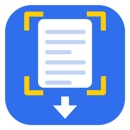
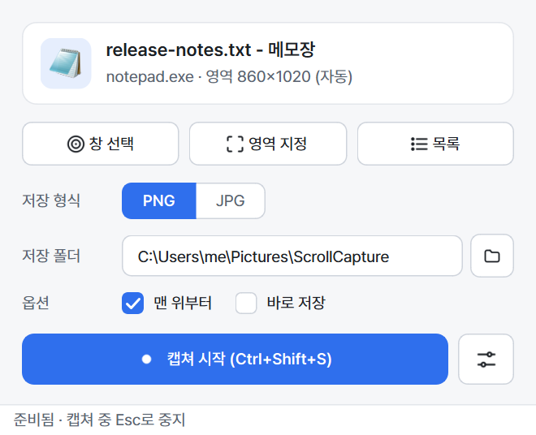
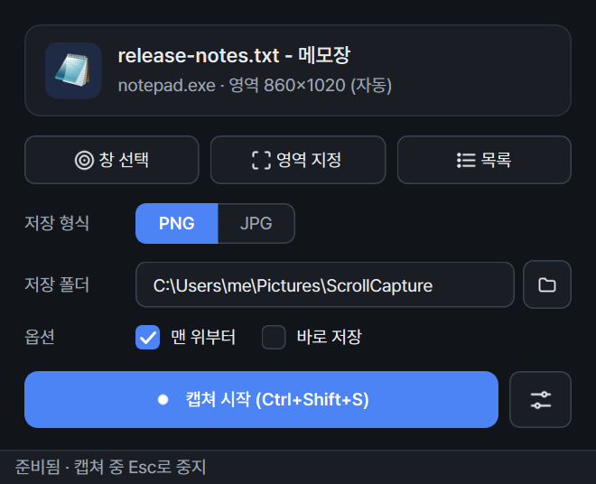
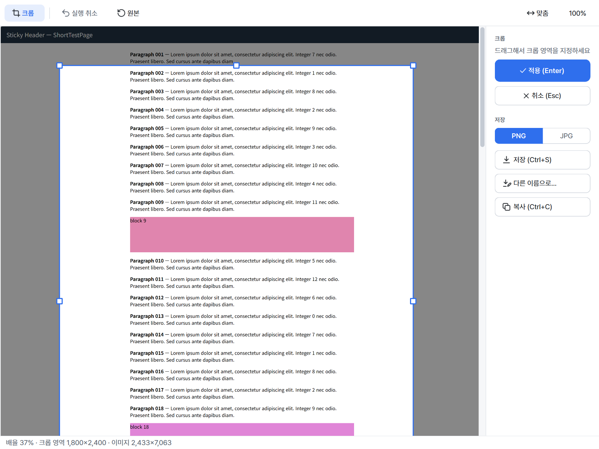

<p align="center"></p>

<h1 align="center">ScrollCapture</h1>

<p align="center">
브라우저, Outlook 메일, 메모장, 탐색기, PDF 뷰어 등 <b>스크롤되는 모든 Windows 프로그램</b>을 한 장의 긴 이미지로 캡쳐합니다.
</p>

<p align="center">
<a href="https://github.com/mainyh/scroll-capture/releases/latest"></a>
<a href="LICENSE"></a>
<a href="https://github.com/mainyh/scroll-capture/releases"></a>
</p>

<p align="center">한국어 · <a href="README.md">English</a></p>

---

브라우저 확장이나 앱 플러그인 없이 동작합니다. 선택한 창을 일반 마우스 휠 입력으로 스크롤하면서
화면을 캡쳐하고, 겹치는 부분을 찾아 이음새 없이 한 장으로 이어 붙입니다. 상단 고정 메뉴,
떠 있는 버튼, 스크롤바도 자동으로 처리합니다.

<p align="center"> </p>

## 주요 기능

- **모든 프로그램 지원**: Chrome, Edge, Firefox, Outlook(클래식/새 Outlook), 메모장, 탐색기, Word, PDF 뷰어, Electron 앱
- **창 선택 / 영역 지정**: 마우스를 올리면 창이 강조되고, 클릭하면 선택, 드래그하면 일부 영역만 캡쳐
- **스크롤 영역 자동 감지**: 예를 들어 Outlook에서는 도구 모음 없이 메일 본문만 캡쳐
- **이음새 없는 합성**: 고정 헤더/푸터와 떠 있는 버튼은 한 번만 나오고 스크롤바는 잘라냄
- **크롭 편집**: 8방향 핸들, 실행 취소, 맞춤/100% 보기
- **PNG(기본) / JPG 저장**, 클립보드 복사
- **전역 단축키** `Ctrl+Shift+S` (변경 가능), 캡쳐 중 `Esc`로 중지
- **한국어 / 영어 UI** (Windows 표시 언어 자동 적용), **라이트/다크 테마** 자동 전환, Pretendard 글꼴
- 설치가 필요 없는 실행 파일 1개

## 다운로드

1. **[Releases](https://github.com/mainyh/scroll-capture/releases/latest)**에서 `ScrollCapture-vX.Y.Z-win-x64.exe`(또는 `.zip`)를 받습니다.
2. 실행하면 됩니다. 설치는 필요 없습니다.

> **Windows SmartScreen 경고:** 아직 코드 서명이 없는 실행 파일이라 처음 실행할 때
> "Windows의 PC 보호" 창이 뜰 수 있습니다. **추가 정보 → 실행**을 누르세요.
> 릴리즈의 `SHA256SUMS.txt`로 파일이 변조되지 않았는지 확인할 수 있습니다:
> ```powershell
> Get-FileHash .\ScrollCapture-vX.Y.Z-win-x64.exe -Algorithm SHA256
> ```

지원 환경: Windows 10(2004 이상) / Windows 11, 64비트

## 사용 방법

1. **`Ctrl+Shift+S`**를 누르거나 **캡쳐 시작**을 누릅니다.
2. 캡쳐할 창 위에 마우스를 올리면 빨간 테두리가 표시됩니다. 스크롤되는 부분(예: 메일 본문)을
   **클릭**하세요. 일부만 캡쳐하려면 원하는 영역을 **드래그**합니다.
3. 맨 위로 이동한 뒤 끝까지 자동으로 스크롤하며 캡쳐합니다. 화면 구석에 진행 상황이 표시되고,
   **`Esc`**를 누르면 그때까지 캡쳐한 내용으로 마무리합니다.
4. 결과 창에서 필요하면 **크롭**한 뒤 **저장**(PNG/JPG)하거나 **복사**합니다.

팁: **바로 저장**을 켜면 결과 창 없이 저장 폴더에 바로 저장됩니다.

| 키 | 동작 |
|---|---|
| `Ctrl+Shift+S` | 창 선택 후 캡쳐 (전역) |
| `Esc` | 선택 취소 / 캡쳐 중지 |
| `C` | 크롭 모드 (결과 창) |
| `Enter` / `Esc` | 크롭 적용 / 취소 |
| `Ctrl+Z` | 실행 취소 |
| `Ctrl+S` / `Ctrl+Shift+S` | 저장 / 다른 이름으로 저장 |
| `Ctrl+C` | 클립보드 복사 |
| `Ctrl+0` / `Ctrl+1` / `Ctrl+휠` | 너비 맞춤 / 100% / 확대·축소 |

<p align="center"></p>

## 설정

설정은 `%APPDATA%\ScrollCapture\settings.json`에, 로그는 `%APPDATA%\ScrollCapture\scrollcapture.log`에 저장됩니다.

| 탭 | 항목 (기본값) |
|---|---|
| 일반 | 언어(시스템) · 저장 폴더(`사진\ScrollCapture`) · 형식(PNG) · JPG 품질(90) · 파일명 패턴(`ScrollCapture_{title}_{datetime}`) · 바로 저장 · 저장 후 폴더 열기 · PNG에 캡쳐 정보 기록 |
| 캡쳐 | 맨 위부터 시작(켬) · 스크롤 양(자동) · 프레임 대기(250ms) · 최대 높이(30,000px) · 고정 헤더/푸터 제거(켬) |
| 단축키 | 캡쳐 시작(`Ctrl+Shift+S`) |

## 알려진 제한

- **관리자 권한**으로 실행 중인 창은 일반 권한 프로그램의 입력을 받지 않습니다. 이런 창은 ScrollCapture도 관리자 권한으로 실행해야 캡쳐됩니다.
- **DRM 보호 동영상** 영역은 검게 나옵니다 (Windows가 캡쳐를 막습니다).
- **무한 스크롤** 페이지(SNS 피드 등)는 최대 높이에서 멈춥니다.
- 스크롤 중 내용이 바뀌는 페이지(애니메이션, 동영상, 자동 회전 배너)는 작은 이음새가 생길 수 있습니다.
- JPG는 높이 65,535px까지만 저장됩니다. 더 긴 캡쳐는 PNG로 저장하거나 나눠서 저장할 수 있습니다.
- 캡쳐 중에는 마우스 커서가 대상 창 위로 이동하므로 끝날 때까지 마우스를 쓰지 마세요.

## 소스에서 빌드

```powershell
git clone https://github.com/mainyh/scroll-capture.git
cd scroll-capture
py -3.11 -m venv .venv
.venv\Scripts\activate
pip install -r requirements.txt
pip install -e .
python -m scrollcapture          # 소스로 실행
pytest                           # 테스트
pyinstaller scrollcapture.spec   # -> dist\ScrollCapture.exe
```

`vX.Y.Z` 태그를 푸시하면 GitHub Actions가 릴리즈 파일을 만들어 올립니다(`.github/workflows/release.yml`).
기획서는 [`docs/planning.html`](docs/planning.html)에 있습니다.

## 기여

버그 제보와 PR을 환영합니다. 캡쳐 문제를 제보할 때는 프로그램 이름·버전, 디스플레이 배율(100%/125%/150%…),
로그 파일을 함께 첨부해 주세요.

## 라이선스

[MIT](LICENSE) © 2026 김용훈 (mainyh). 함께 배포되는 오픈소스 목록은 [THIRD_PARTY_NOTICES.md](THIRD_PARTY_NOTICES.md)에 있습니다
(Qt/PySide6는 LGPL-3.0으로 사용).
