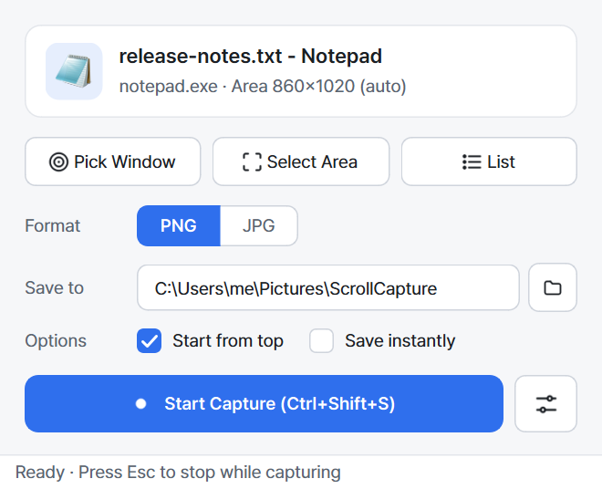
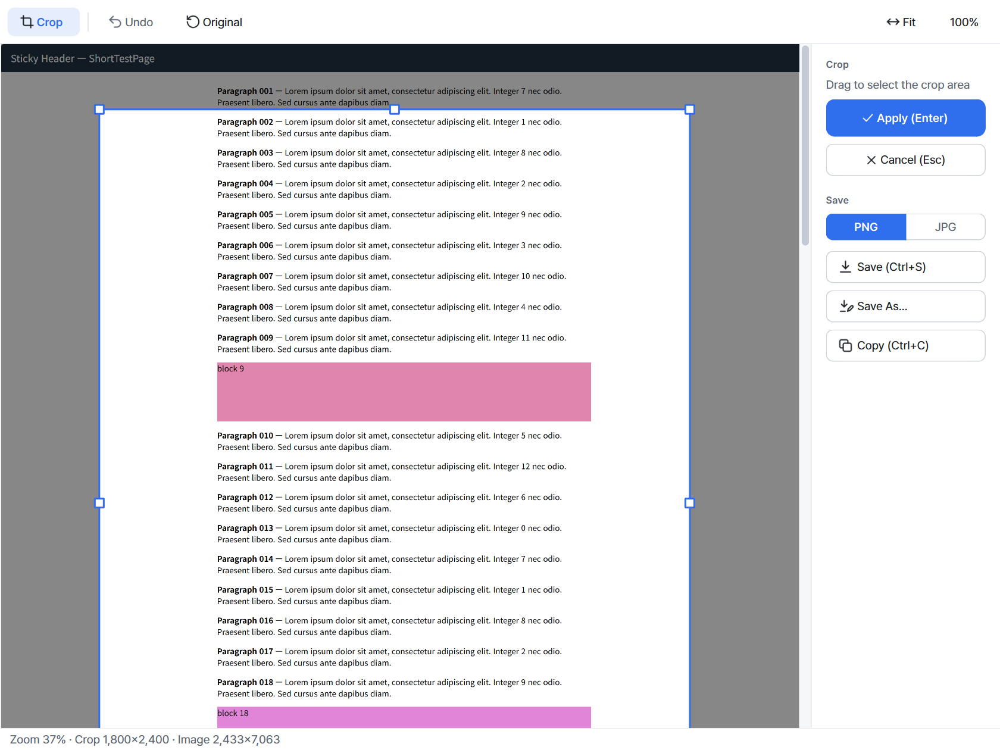

<p align="center"></p>

<h1 align="center">ScrollCapture</h1>

<p align="center">
Capture any scrollable Windows app — browsers, Outlook mail, Notepad, Explorer, PDF viewers — into <b>one long image</b>.
</p>

<p align="center">
<a href="https://github.com/mainyh/scroll-capture/releases/latest"></a>
<a href="LICENSE"></a>
<a href="https://github.com/mainyh/scroll-capture/releases"></a>
</p>

<p align="center"><a href="README.ko.md">한국어</a> · English · <a href="CODE_SIGNING_POLICY.md">Code signing policy</a></p>

---

ScrollCapture doesn't rely on browser extensions or app plugins. It scrolls the window you pick with
ordinary mouse-wheel input, grabs the screen after each step, and stitches the frames together
seamlessly. Sticky headers, floating buttons and scrollbars are handled automatically.

<p align="center"></p>

## Features

- **Works with any app**: Chrome, Edge, Firefox, Outlook (classic and new), Notepad, Explorer, Word, PDF viewers, Electron apps
- **Pick a window or drag an area**: hover to highlight a window, click to pick it, or drag to capture only part of it
- **Finds the scroll area automatically**, e.g. only the reading pane in Outlook, without the toolbars
- **Seamless stitching**: sticky headers/footers and floating buttons appear only once, and scrollbars are trimmed
- **Crop editor** with 8 handles, undo, fit/100% zoom
- **PNG (default) or JPG**; copy to clipboard
- **Global hotkey** `Ctrl+Shift+S` (configurable); `Esc` stops a capture
- **Korean / English UI** (follows the Windows display language), automatic **light/dark theme**, Pretendard font
- Single portable `.exe`, no installation

## Download

1. Download `ScrollCapture-vX.Y.Z-win-x64.exe` (or the `.zip`) from **[Releases](https://github.com/mainyh/scroll-capture/releases/latest)**.
2. Run it. No installation is needed.

> **Windows SmartScreen:** the executable is not code-signed yet, so Windows may show
> "Windows protected your PC". Click **More info → Run anyway**.
> You can verify the download against `SHA256SUMS.txt` from the release:
> ```powershell
> Get-FileHash .\ScrollCapture-vX.Y.Z-win-x64.exe -Algorithm SHA256
> ```

Requirements: Windows 10 (2004+) or Windows 11, x64.

**Uninstall:** ScrollCapture is portable. Delete `ScrollCapture.exe` and the folder `%APPDATA%\ScrollCapture`.

### Code signing policy

Free code signing provided by [SignPath.io](https://about.signpath.io/), certificate by [SignPath Foundation](https://signpath.org/)
(application in progress; releases up to v0.9.2 are unsigned).
Release binaries are built from this repository by GitHub Actions and every signing request is approved manually.
See the full [code signing policy](CODE_SIGNING_POLICY.md), including team roles and the privacy policy:
*this program will not transfer any information to other networked systems unless specifically requested by
the user or the person installing or operating it.*

## How to use

1. Press **`Ctrl+Shift+S`** (or **Start Capture**).
2. Hover over the window you want. It is outlined in red. **Click** the part that scrolls
   (for example, the mail body). To capture only part of the window, **drag** a rectangle.
3. ScrollCapture scrolls to the top and then down to the end, capturing as it goes.
   A small panel shows progress. Press **`Esc`** to stop early; what was captured so far is kept.
4. The result opens in the editor. **Crop** if needed, then **Save** (PNG/JPG) or **Copy**.

Tip: enable **Save instantly** to skip the editor and save straight to the folder.

| Key | Action |
|---|---|
| `Ctrl+Shift+S` | Pick a window and capture (global) |
| `Esc` | Cancel picking / stop capturing |
| `C` | Crop mode (editor) |
| `Enter` / `Esc` | Apply / cancel crop |
| `Ctrl+Z` | Undo |
| `Ctrl+S` / `Ctrl+Shift+S` | Save / Save As |
| `Ctrl+C` | Copy to clipboard |
| `Ctrl+0` / `Ctrl+1` / `Ctrl+wheel` | Fit width / 100% / zoom |

<p align="center"></p>

## Settings

Settings are stored in `%APPDATA%\ScrollCapture\settings.json`; a log is written to
`%APPDATA%\ScrollCapture\scrollcapture.log`.

| Group | Options (default) |
|---|---|
| General | Language (system) · Save folder (`Pictures\ScrollCapture`) · Format (PNG) · JPG quality (90) · File name pattern (`ScrollCapture_{title}_{datetime}`) · Save instantly · Open folder after saving · Embed capture info in PNG |
| Capture | Start from top (on) · Scroll amount (auto) · Frame delay (250 ms) · Max height (30,000 px) · Remove sticky header/footer (on) |
| Hotkeys | Start capture (`Ctrl+Shift+S`) |

## Known limitations

- Windows running **as administrator** can't receive input from a non-elevated app. Run ScrollCapture as administrator to capture them.
- **DRM-protected video** areas appear black (Windows blocks capturing them).
- **Infinite-scroll** pages (social feeds) stop at the maximum height.
- Content that changes while scrolling (animations, videos, auto-rotating banners) can leave small seams.
- JPG is limited to 65,535 px in height. Taller captures can be saved as PNG or split into parts.
- ScrollCapture moves the mouse cursor over the target while capturing, so avoid using the mouse until it finishes.

## Build from source

```powershell
git clone https://github.com/mainyh/scroll-capture.git
cd scroll-capture
py -3.11 -m venv .venv
.venv\Scripts\activate
pip install -r requirements.txt
pip install -e .
python -m scrollcapture          # run from source
pytest                           # tests
pyinstaller scrollcapture.spec   # -> dist\ScrollCapture.exe
```

Releases are built by GitHub Actions when a `vX.Y.Z` tag is pushed (`.github/workflows/release.yml`).
The design document (Korean) is in [`docs/planning.html`](docs/planning.html).

### How it works

1. Find the deepest child window under the click and test-scroll it to locate the region that moves.
2. Scroll with `SendInput` mouse-wheel events and wait until the screen stops changing (smooth scrolling).
3. Hash every row of each frame in 8 column bands and find the vertical offset where the most
   non-blank rows line up exactly. A tolerant grayscale matcher is used as a fallback.
4. Rows that stay identical at the top/bottom are sticky headers/footers; elements that don't move
   with the content near the bottom (chat buttons) are kept out of the middle of the image; the
   scrollbar column is trimmed.

## Contributing

Bug reports and pull requests are welcome. When reporting a capture problem, please include the
app name and version, your display scaling (100%/125%/150%…) and the log file.

## License

[MIT](LICENSE) © 2026 김용훈 (mainyh). Third-party components are listed in [THIRD_PARTY_NOTICES.md](THIRD_PARTY_NOTICES.md)
(Qt/PySide6 are used under the LGPL-3.0).
